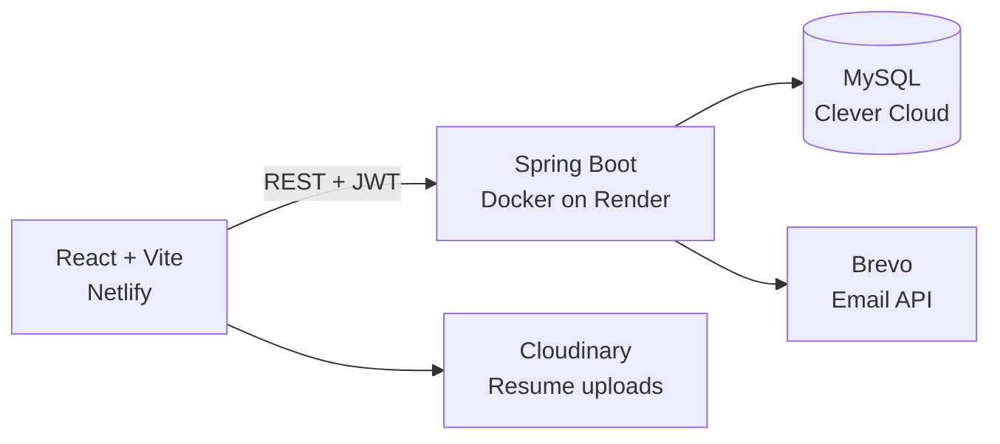

<!--
  LEARNING NOTES (safe to delete before committing)

  1. This file must live in a repo named exactly like your username
     (r0hitgit/r0hitgit) for it to show on your profile page.
  2. HTML comments like this one are invisible on GitHub, so they are
     a good place to leave notes for yourself.
  3. Most visuals here are images loaded from third-party services via
     URL query parameters. Changing the URL changes the image, so you
     can tweak colours and text without any design tool.
-->

<!-- ============ HEADER BANNER ============ -->
<!-- capsule-render draws the gradient wave. Key parameters:
     type=waving   -> wave shape (others: venom, soft, rect, cylinder)
     color=0:..    -> gradient stops written as position:hexcolor
     text=         -> main title (%20 is a space, %2C is a comma)
     desc=         -> subtitle line
     animation=fadeIn -> simple load animation -->
<div align="center">
  
</div>

<!-- ============ TYPING ANIMATION ============ -->
<!-- The lines= parameter is separated by semicolons; each one is typed
     out in turn. Plus signs encode spaces. -->
<div align="center">
  <a href="https://git.io/typing-svg">
    
  </a>
</div>

<br/>

<!-- ============ QUICK LINKS ============ -->
<!-- shields.io "for-the-badge" style. Format: /badge/<label>-<colour>
     The logo= value comes from the simple-icons catalogue. -->
<div align="center">
  <a href="https://r0hithiside.vercel.app"></a>
  <a href="https://www.linkedin.com/in/r0hitin"></a>
  <a href="https://nexhire.me"></a>
  <a href="https://genericmeds-ai.vercel.app"></a>
</div>

<br/>

<div align="center">


</div>

---

## About Me

<!-- A two-column table is a common trick: left cell holds text,
     right cell holds a visual. GitHub strips most CSS, so tables
     and align attributes are the reliable layout tools. -->
<table>
<tr>
<td width="62%" valign="top">

- B.Tech CSE (AI & ML) '27 at **NIET**, Greater Noida
- I build end to end: backend APIs, frontend UI and the deployment pipeline
- Shipped **[NexHire](https://nexhire.me)**, a production job portal, and **[GenericMeds-AI](https://genericmeds-ai.vercel.app)**, an AI-assisted generic medicine finder
- Sharpening **DSA in Java** and exploring **System Design**
- Looking for **SDE internship opportunities**
- Fun fact: when I start building, the world disappears. I don't stop until it works.

</td>
<td width="38%" valign="top" align="center">

<!-- A small "terminal card" written in a fenced code block.
     The language tag (java) gives it syntax colours. -->

```java
public class Rohit {
  String role  = "Full Stack Dev";
  String stack = "Spring Boot + React";
  String goal  = "SDE Internship";

  void build() {
    while (!works) { keepGoing(); }
  }
}
```

</td>
</tr>
</table>

---

## Featured Projects

<!-- Three project cards in one table row. Each cell is its own card.
     Keeping descriptions to 2-3 lines keeps the row readable on mobile. -->

<table>
<tr>
<td width="33%" valign="top">

### NexHire
**Production full-stack job portal**

Role-based platform for candidates, recruiters and admins with JWT auth, email OTP, resume uploads and interview scheduling.

`Spring Boot` `React` `MySQL` `Docker` `JWT`

[Live Site](https://nexhire.me) | [Repo](https://github.com/r0hitgit/NexHire)

</td>
<td width="33%" valign="top">

### GenericMeds-AI
**Generic medicine and PMBJP price comparison**

Indexes 1,800+ Jan Aushadhi formulations and 10,000+ kendras, with a bilingual (English and Hindi) AI assistant and a geospatial Kendra Locator.

`React` `FastAPI` `Gemini API` `SQLite` `Vercel`

[Live Site](https://genericmeds-ai.vercel.app) | [Repo](https://github.com/r0hitgit/genericmeds-ai)

</td>
<td width="33%" valign="top">

### Developer Portfolio
**Terminal-themed personal site with an admin CMS**

Spring Boot backend and React frontend with a terminal-style UI. Content is managed through a JWT-protected admin panel instead of being hardcoded.

`Spring Boot` `React` `JWT` `Vercel`

[Live Site](https://r0hithiside.vercel.app) | [Repo](https://github.com/r0hitgit/portFolio)

</td>
</tr>
</table>

### NexHire at a glance

<!-- GitHub renders Mermaid diagrams natively inside a fenced block
     tagged "mermaid". "LR" means left-to-right layout. -->



---

## Tech Stack

<!-- skillicons.dev builds one icon strip from a comma-separated list.
     perline= controls the wrap point. Icon ids must match their catalogue
     (for example "spring", "fastapi", "py"). -->
<div align="center">
  
</div>

<br/>

<!-- <details> makes a collapsible section so the README stays short
     but still lists everything for recruiters who want detail. -->
<details>
<summary><b>Full skill breakdown</b></summary>

<br/>

**Languages**


**Backend**


**Frontend**


**Database, AI and DevOps**


</details>

---

## Achievements

<!-- Only claims you can back up with a certificate or a ranking.
     Recruiters do click through, so accuracy matters more than hype. -->

- **NCET Plus SDE (Java) Certification**: Grade O (Outstanding), 88.44%, August 2026
- **AI Hackathon at AURIX 2026** (IILM University): Software Track, qualified for Round 2 and ranked 2nd among the Top 15 teams
- **Dataverse Hackathon**: reached the pre-final round at NSUT, Delhi, 2024
- **150+ DSA problems** solved on LeetCode

---

## GitHub Stats

<!-- FIX NOTES
     The old github-readme-stats cards came from the shared public
     instance (github-readme-stats.vercel.app), which is often over its
     GitHub API limit and then returns a broken image. They are removed.

     What replaced them, and why each is more dependable:
     1. shields.io badges: shields caches results, so they rarely break.
     2. streak-stats (demolab): this one was already rendering for you.
     3. ghchart.rshah.org: a plain SVG of your contribution graph, with
        the hex colour in the URL path set to your purple. -->
<div align="center">


</div>

<div align="center">
  
</div>

<br/>

<div align="center">
  
</div>

---

## Let's Connect

<div align="center">

I'm actively looking for **SDE internships**. If you are hiring, or just want to talk about Java, Spring Boot or building things, reach out.

<a href="https://r0hithiside.vercel.app"></a>
<a href="https://www.linkedin.com/in/r0hitin"></a>

</div>

<!-- Footer wave: same capsule-render service with section=footer and
     reversed=true so the gradient mirrors the header. -->
<div align="center">
  
</div>
